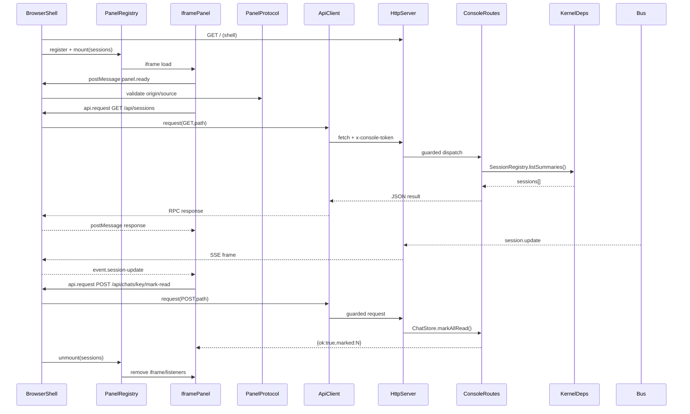
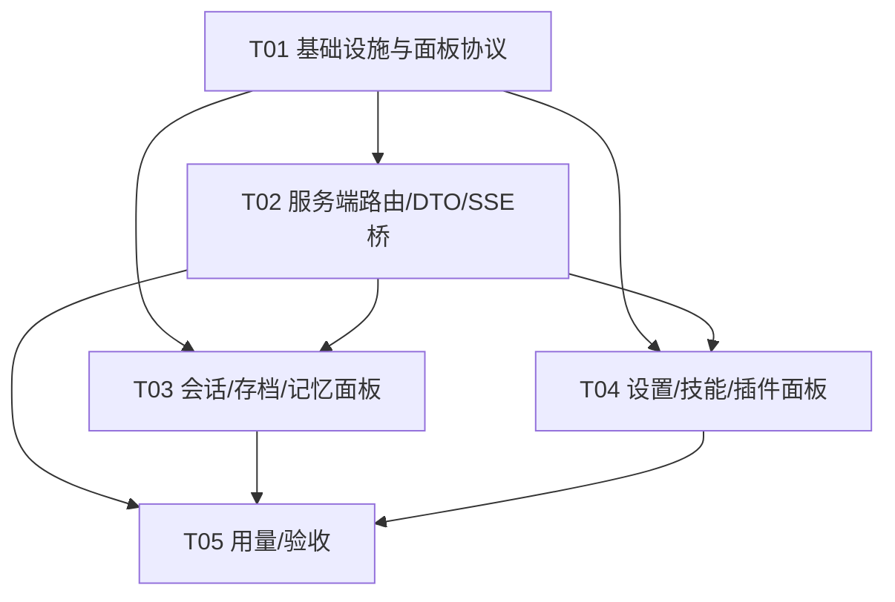

# QQ Agent 0.5 · M3 控制台增量架构审计与设计

> 范围更新（2026-10-24）：用户自行下载并放入 `protocols/` 的 NapCat / SnowLuma 完整发行包现已纳入本地识别、解压、启动和 OneBot 配置适配；QQ-Agent 不附带、下载或再分发这些运行时及 QQ 客户端，不代替用户确认上游协议，不迁移登录态。本文其余旧编号、测试数量与结果仅对应当时范围，不代表当前版本已经完成验收。最新使用边界见 [protocols/README.md](../protocols/README.md)。

> 审计范围：`v0.5` 当前实现（仅 `src/`、`ui/shell/`）以及只读规格 `dsh-spec/SPEC.md` §9/§10、`notes/09b-route-contracts.md`、`notes/10-ui.md`。严禁读取 `develop/` 源码。本文件只做设计，不代表代码已实现。

## 1. Implementation Approach

### 1.1 现状与难点

v0.5 是 Node 20 ESM 的 DSH 薄内核：`kernel.js` 装配配置、存档、会话、插件、OneBot、编排器和 HTTP；`http.js` 提供本地回环 HTTP、静态资源、SSE、来源/体积守卫。当前 shell 只有插件清单、日志与基础状态，距离规格中的 90 条 REST 路由和 8 页签控制台差距很大。

M3 的关键难点：

1. **行为等价而非仅补页面**：路由状态码、body 限制、错误文案、脱敏密钥、冲突语义和异步事件都是可观察契约。
2. **SSE 安全与完整性**：当前 `/api/events` 在 `handleApi` 前被裸处理，未复用 token/origin 守卫；bus 事件也尚未桥接至 SSE。
3. **内核与页面解耦**：页面不能把 DOM 或业务流程写进 kernel；通过集中式 console adapter + shell bridge + iframe panel 承载扩展。
4. **存储边界**：`Config`、`ChatStore`、`SessionRegistry`、`MemoryStore`、`PluginLoader` 已具备核心能力，但需要统一 DTO、参数校验及安全的 CRUD 外壳。
5. **范围控制**：R-01…R-90 不应一次性线性重写；按 P0（安全、状态、会话闭环）→ P1（设置/用量/设备）→ P2（市场外围）交付。

### 1.2 技术选择与架构

- **服务端**：Node.js >=20 原生 `http`、`fs`、`URL`、`AbortController`；不新增 Web 框架，保留当前 HTTP 服务器和回环绑定。
- **前端**：当前 shell 的原生 HTML/CSS/JavaScript；不引入 React/Vite，避免破坏 headless 与单文件静态服务。每个面板是独立 iframe（HTML + JS + CSS）。
- **验证**：优先手写轻量 JSON-RPC validator；可选 `ajv` 仅用于复杂 schema，不作为 M3 必选运行时依赖。
- **模式**：服务端采用 Adapter/Serializer 分层（REST 路由 → DTO/序列化 → 已有 kernel service）；前端采用 Shell + Panel Registry + State Store，iframe 面板采用 MVVM-ish 的 state/render 分离。
- **原则**：shell 只负责导航、鉴权代理、SSE 单连接、RPC 路由；面板负责本页渲染；kernel 只暴露服务和事件，不引用 DOM、iframe、postMessage。

### 1.3 当前实现路由 vs R-01…R-90 对账

状态含义：**已**=路径和主要能力存在；**部分**=存在近似接口但字段/契约不完整；**缺**=当前 v0.5 无实现；**错位**=有能力但路径与规格不一致。

| R | 路由/功能 | 状态 | 审计结论 |
|---|---|---|---|
| R-01 | GET /api/status | 部分 | 有基础 status；缺 cost/cacheHitRate 等规格字段。 |
| R-02~R-03 | open-data-dir/reset-data | 缺 | 无数据目录打开、备份重置。 |
| R-04~R-05 | usage stats/breakdown | 缺 | 仅有额外 `/api/usage/today`。 |
| R-06~R-07 | model-prices/refresh | 缺 | 无价格源与缓存接口。 |
| R-17~R-18 | OneBot groups/friends | 缺 | provider 存在但无控制台列表路由。 |
| R-19~R-21 | persona templates CRUD | 缺 | 无模板接口。 |
| R-22~R-26 | providers/key/api-key/search-key/token | 缺 | 未提供目录或明文密钥受控端点。 |
| R-27~R-35 | provider/model fetch/test/CRUD | 缺 | 无 provider 管理接口。 |
| R-36~R-37 | vision results/scan | 缺 | 无视觉扫描状态。 |
| R-38~R-41 | search-providers CRUD/test | 缺 | 无搜索源控制台接口。 |
| R-42 | POST /api/test/api | 缺 | 无连接测试接口。 |
| R-43 | GET/POST /api/config | 部分 | 已有脱敏、deepMerge、原子写；缺完整路由副作用和契约校验。 |
| R-44 | prompt-preview | 缺 | 无临时补丁预览。 |
| R-45~R-52 | community/market 全组 | 缺 | 无屏蔽名单、账号、登录、发布、verify、install。 |
| R-53 | GET /api/skills | 部分 | 有 loader 列表；缺完整 status/summary/capabilities/uninstalled/settings 脱敏字段。 |
| R-54 | skills/reload | 缺 | loader 有 `loadAll`，无路由。 |
| R-55 | skills/cleanup | 缺 | 无残留配置清理。 |
| R-56 | POST /api/skills/:id | 错位 | 有 `/api/skills/:id/enabled`，缺 settings、生命周期和完整响应。 |
| R-57 | skills/capabilities | 缺 | 仅额外 `/api/capabilities`，结构不同。 |
| R-58 | tools/availability | 缺 | registry 能力未对外形成运行时同口径矩阵。 |
| R-59 | POST /api/config | 部分 | 基础更新存在；缺 preserve/derived flags 等 M3 路由验收和联动。 |
| R-60 | GET /api/tools | 缺 | 无全量工具清单路由。 |
| R-61 | GET /api/version | 已 | 已注册并返回 version/appId/profile。 |
| R-62~R-63 | update-check/models | 缺 | 无远程版本或模型列表。 |
| R-64 | GET /api/sessions | 部分 | 列表已实现，忽略 `limit`。 |
| R-65 | GET /api/sessions/:id | 缺 | `SessionRegistry.get` 存在但无路由。 |
| R-66 | DELETE session | 缺 | 无删除和运行中 409 闸。 |
| R-67 | clear-finished | 缺 | 无批量清理。 |
| R-68 | retry | 部分 | 路由已注册，需核对五种 409 和原 id 复用。 |
| R-69 | abort | 部分 | 路由已注册，需核对缺 id/状态及 AbortController 语义。 |
| R-70 | GET /api/chats | 部分 | 基础列表已实现，缺 chatName/契约字段。 |
| R-71~R-76 | memory files CRUD/consolidate | 缺 | MemoryStore 有基础能力，但无规格路径、成员约束、异步整理。 |
| R-77 | chat messages | 部分 | 已有 messages 路由；使用 `n` 且最多 500，非规格 `limit` 分页。 |
| R-78 | media-data | 缺 | 无安全图片数据聚合。 |
| R-79 | group members | 缺 | 无 OneBot 成员列表路由。 |
| R-80 | wake (恒 410) | 缺 | 未提供兼容 410 端点。 |
| R-81 | test-send | 缺 | 无白/黑名单闸及直发接口。 |
| R-82 | mark-read | 错位 | 有 `/api/chats/:key/read`，需改为 `/mark-read` 并保留兼容别名。 |
| R-83 | clear chat | 缺 | store 有 clearChat，但无路由。 |
| R-84 | mute | 缺 | 需按规格仅标未读。 |
| R-85 | delete-messages | 缺 | store 有 removeByLocalIds，但无路由。 |
| R-86 | POST /api/pause | 部分 | 固定 pause，忽略 body.paused/skipBacklog 与事件。 |
| R-87 | DELETE /api/pause | 缺 | 无恢复并全部标读。 |
| R-88 | GET /api/logs | 部分 | 有 `n` 查询，返回缺 `level`，规格是 `limit`。 |
| R-89 | POST /api/logs/level | 已 | 内存级别、非法级别保持原级别，符合 SUSPECT。 |
| R-90 | captcha-forward | 缺 | 无白名单代理。 |

额外现有但非 R-01…R-90 的接口：`GET /api/capabilities`、`POST /api/resume`、`GET /api/usage/today`、`GET /api/memory/:key`、`POST /api/skills/:id/enabled`。

**R-91 SSE**：`http.js` 有 hello、ping、broadcast，但当前事件桥未在 kernel 接线；更严重的是 `/api/events` 分支绕过 token/origin 守卫，必须 P0 修复。

### 1.4 M3 缺口优先级

- **P0**：SSE 鉴权/来源校验；bus→SSE 事件桥；完整 shell/8 页签框架；status/config/version/skills/sessions/chats/logs 的契约对齐；sessions 和 chats 基础 CRUD；skills/plugin 启停与 reload；iframe/RPC 安全。
- **P1**：memory CRUD/consolidate、usage stats/breakdown、provider/model/settings、OneBot groups/friends、prompt-preview、tools availability、pause 完整语义、media-data。
- **P2**：community/market、captcha-forward、vision scan、price feed、update-check、搜索源高级管理、open-data-dir/reset-data。

## 2. File List

### 已有基础（保留并接线）

- `src/kernel/kernel.js`：内核装配及既有服务。
- `src/kernel/http.js`：HTTP 守卫、路由注册、SSE、静态文件。
- `src/kernel/config.js`：配置读取/脱敏/原子写。
- `src/kernel/store.js`：聊天存档。
- `src/kernel/sessions.js`：会话存档与状态。
- `src/kernel/memory.js`：成员印象存储。
- `src/kernel/plugin-loader.js`：技能/插件装载与启停。
- `src/kernel/orchestrator.js`：暂停、恢复、重试、中止。
- `src/kernel/bus.js`：事件总线。
- `src/kernel/log.js`：日志环。
- `ui/shell/index.html`、`style.css`、`app.js`：当前控制台壳，M3 重构。

### M3 新增服务端

- `src/console/routes.js`：R 路由集中注册和参数校验。
- `src/console/serializers.js`：Status/Session/Chat/Skill/Config 脱敏 DTO。
- `src/console/sse-bridge.js`：bus 事件到 SSE 名称/载荷映射。
- `src/console/panel-protocol.js`：RPC 信封、错误码、方法白名单。

### M3 新增前端壳

- `ui/shell/panel-registry.js`：页签到 iframe 面板的注册/挂载/销毁。
- `ui/shell/rpc-bridge.js`：postMessage JSON-RPC bridge。
- `ui/shell/api-client.js`：token、超时、错误映射、fetch 代理。
- `ui/shell/sse-client.js`：单 SSE 连接、重连、事件订阅。
- `ui/shell/state-store.js`：跨面板只读快照与订阅。
- `ui/shell/escape.js`：安全文本/时间/金额格式化。

### M3 面板（每页独立，可追加）

- `ui/panels/sessions/index.html`、`panel.js`、`style.css`
- `ui/panels/chats/index.html`、`panel.js`、`style.css`
- `ui/panels/memory/index.html`、`panel.js`、`style.css`
- `ui/panels/usage/index.html`、`panel.js`、`style.css`
- `ui/panels/skills/index.html`、`panel.js`、`style.css`
- `ui/panels/plugins/index.html`、`panel.js`、`style.css`
- `ui/panels/settings/index.html`、`panel.js`、`style.css`

### 测试与文档

- `test/m3-console-routes-test.mjs`
- `test/m3-sse-test.mjs`
- `test/m3-panels-test.mjs`
- `docs/class-diagram.mermaid`
- `docs/sequence-diagram.mermaid`
- `docs/system_design.md`

## 3. Data Structures and Interfaces

核心 DTO：

```text
ApiResponse<T> = { ok?: boolean, data?: T, error?: string, message?: string }
Status = { version, dataDir, uptimeMs, paused, pauseReason,
  onebot:{connected,selfId,diagnosis},
  orchestrator:{running,consolidating},
  usage, cost, cacheHitRate }
SessionSummary = { id, chatKey, startedAt, endedAt, status, waitUntil,
  activity, webSearchCount, outcome, usage, model, trigger, promptChars, rounds }
ChatSummary = { key, chatKey, total, unread, lastTs, lastText, chatName }
SkillStatus = { id, name, version, kind, loaded, enabled, available, active,
  code, reason, settings, configSchema, requires, toolIds }
```

面板 JSON-RPC 2.0：

```text
PanelRequest  = { jsonrpc:"2.0", id?:string, method:string, params?:object,
                 meta:{panel:string, version:string, ts:string} }
PanelResponse = { jsonrpc:"2.0", id:string, result?:any,
                 error?:{code:number, message:string, data?:object} }
```



```mermaid
classDiagram
  class ConsoleRoutes { +register(http, deps); +status(); +configGet(); +configPatch(patch); +sessionList(limit); +sessionGet(id); +sessionDelete(id); +chatList(); +chatMessages(key, limit); +chatControl(key, op, body); +skillList(kind); +skillPatch(id, body) }
  class PanelProtocol { +validateRequest(req); +handle(req, ctx); +makeResponse(id,result); +makeError(id,code,msg) }
  class SseBridge { +subscribe(bus); +broadcast(event,payload); +snapshot() }
  class PanelRegistry { +register(def); +mount(id); +unmount(id); +routeMessage(ev) }
  class ApiClient { +request(method,path,params); +get(path,query); +post(path,body) }
  class StateStore { +set(patch); +get(); +subscribe(fn) }
  class Config { +get(); +update(patch); +load(); +onChange(fn) }
  class ChatStore { +listChats(); +recent(key,n); +markAllRead(key); +clearChat(key); +removeByLocalIds(key,ids) }
  class SessionRegistry { +listSummaries(); +get(id); +finish(id,status); +delete(id) }
  class PluginLoader { +listEntries(); +setEnabled(id,enabled); +loadAll(); +unload(id) }
  class Orchestrator { +status(); +pause(); +resume(); +retrySession(id); +abortSession(id) }
  class HttpServer { +route(method,pattern,handler); +listen(); +broadcast(event,payload) }
  ConsoleRoutes --> Config
  ConsoleRoutes --> ChatStore
  ConsoleRoutes --> SessionRegistry
  ConsoleRoutes --> PluginLoader
  ConsoleRoutes --> Orchestrator
  ConsoleRoutes --> SseBridge
  HttpServer --> ConsoleRoutes
  SseBridge --> HttpServer
  PanelRegistry --> PanelProtocol
  PanelProtocol --> ApiClient
  PanelProtocol --> StateStore
```

详细图见 [`docs/class-diagram.mermaid`](./class-diagram.mermaid)。

## 4. Program Call Flow

### 4.1 Shell/iframe 初始化

1. Browser GET `/`，shell 读取 token（URL 参数 → localStorage），只由 shell 持有。
2. `PanelRegistry` 根据白名单注册并 mount 当前面板，iframe 使用 `/panels/<id>/index.html`。
3. iframe 发送 `panel.ready`；`rpc-bridge` 验证 `event.origin === location.origin` 且 `event.source === iframe.contentWindow`。
4. shell 建立唯一 EventSource `/api/events?token=…`，面板仅订阅事件，不直接建立 SSE。
5. shell 通过 `ApiClient` 代理面板的 `api.request`，统一附加 `x-console-token`，不把 token 下发 iframe。

### 4.2 REST CRUD 与事件

- 面板请求 `GET /api/sessions` → shell RPC → API client → HTTP 守卫 → `ConsoleRoutes` → `SessionRegistry.listSummaries` → serializer → RPC response。
- 面板请求 `GET /api/sessions/:id`、`DELETE /api/sessions/:id`、`POST retry/abort`，分别调用 `get`、删除闸、编排器控制；冲突返回 409。
- 面板请求 `GET /api/chats/:key/messages`、`POST mark-read/clear/delete-messages/test-send`，路由校验 key/ids/text，并调用 `ChatStore`/OneBot；写操作完成后 bus emit `chat.update`。
- 面板请求 `POST /api/skills/:id`，仅接受 enabled/settings 声明键，调用 `PluginLoader.setEnabled`；成功后 emit plugin/config 状态。
- `Bus` 发出 `session.update`、`chat.update`、`onebot.status` 或 `log` → `SseBridge` 脱敏映射 → `HttpServer.broadcast` → shell → 目标 iframe notification。



完整图见 [`docs/sequence-diagram.mermaid`](./sequence-diagram.mermaid)。

## 5. Anything UNCLEAR

1. `notes/10-ui.md` 的事实根目录是 develop，和 v0.5 shell 不是同一实现；本设计只借用规格中的 8 页签与交互契约，不复制旧源码。
2. 规格的历史 REST 响应不是完全统一的 `{code,data,message}`；M3 保留 REST 兼容字段，在 RPC 层统一 JSON-RPC 错误，不做一次性破坏性改名。
4. `SessionRegistry` 当前对外无 `delete`、`clearFinished`；实现前需确认是否新增服务方法，不能在路由里直接操作私有文件。
5. `MemoryStore` 的“整理”在 orchestrator 注释中明确属于 M4 插件；M3 只能提供 202/事件协议和可插拔 provider，除非产品明确提前纳入。
6. 是否采用 `sandbox="allow-scripts"` 的同源 iframe 仍需安全评审；如果要读取同源 parent，必须维持 postMessage 安全校验，不能依赖同源天然信任。

## 6. Required Packages

- Node.js >=20：原生 HTTP、文件、URL、AbortController、ESM。
- `ws@^8.22.0`：已有 OneBot/WebSocket 依赖，M3 不新增。
- `node:test`：已有 Node 测试运行时。
- `ajv@^8.17.1`（可选）：仅在 JSON-RPC schema 复杂度超过手写校验时引入；M3 默认零新增依赖。

## 7. Task List（按依赖排序）

> 不超过 5 个任务；每个任务包含至少 3 个相关文件；配置、入口、依赖集中于 T01。

### T01 · 项目基础设施与面板协议

- **Source Files**：`package.json`、`ui/shell/index.html`、`ui/shell/style.css`、`ui/shell/app.js`、`ui/shell/panel-registry.js`、`ui/shell/rpc-bridge.js`、`ui/shell/api-client.js`、`ui/shell/sse-client.js`、`ui/shell/state-store.js`、`src/console/panel-protocol.js`
- **Dependencies**：无
- **Priority**：P0
- **验收**：shell 可启动；8 个 panel 白名单可 mount/unmount；RPC origin/source、超时、错误码和 token 代理工作。

### T02 · 服务端路由、DTO 与 SSE 事件桥

- **Source Files**：`src/console/routes.js`、`src/console/serializers.js`、`src/console/sse-bridge.js`、`src/kernel/kernel.js`、`src/kernel/http.js`、`src/kernel/bus.js`
- **Dependencies**：T01
- **Priority**：P0
- **验收**：修复 `/api/events` 鉴权/来源守卫；接通 bus→SSE；严格对齐 R-01、R-43、R-53、R-61、R-64、R-68、R-69、R-70、R-77、R-82、R-86、R-88、R-89。

### T03 · 会话、存档与记忆面板

- **Source Files**：`ui/panels/sessions/index.html`、`ui/panels/sessions/panel.js`、`ui/panels/sessions/style.css`、`ui/panels/chats/index.html`、`ui/panels/chats/panel.js`、`ui/panels/chats/style.css`、`ui/panels/memory/index.html`、`ui/panels/memory/panel.js`、`ui/panels/memory/style.css`、`src/kernel/sessions.js`、`src/kernel/store.js`、`src/kernel/memory.js`
- **Dependencies**：T01、T02
- **Priority**：P0（memory consolidate 可 P1）
- **验收**：session detail/delete/clear/retry/abort；chat message/mark-read/clear/mute/delete/test-send；memory CRUD 与 SSE 刷新，严守 running/黑白名单/参数冲突。

### T04 · 设置、技能与插件面板

- **Source Files**：`ui/panels/settings/index.html`、`ui/panels/settings/panel.js`、`ui/panels/settings/style.css`、`ui/panels/skills/index.html`、`ui/panels/skills/panel.js`、`ui/panels/skills/style.css`、`ui/panels/plugins/index.html`、`ui/panels/plugins/panel.js`、`ui/panels/plugins/style.css`、`src/kernel/config.js`、`src/kernel/plugin-loader.js`
- **Dependencies**：T01、T02
- **Priority**：P0/P1
- **验收**：脱敏 config/draft 保存、provider/persona/tools 设置骨架；skills/plugins 完整状态、启停、settings、reload、cleanup；不泄漏任何密钥。

### T05 · 用量与 M3 验收

- **Source Files**：`ui/panels/usage/index.html`、`ui/panels/usage/panel.js`、`ui/panels/usage/style.css`、`test/m3-console-routes-test.mjs`、`test/m3-sse-test.mjs`、`test/m3-panels-test.mjs`
- **Dependencies**：T02、T03、T04
- **Priority**：P1/P2
- **验收**：usage 优先功能；补充 R-02…R-42、R-62…R-63、R-90 中已排入版本的项；运行全量测试、headless smoke、SSE 安全回归。

## 8. Shared Knowledge

- REST 保持历史兼容形态 `{ok, data?, error?, message?}`；shell→iframe 使用 JSON-RPC 2.0 `{jsonrpc,id,result|error}`。
- 所有鉴权 token 仅由 shell 的 fetch 代理持有；不得通过 RPC result、iframe URL、state snapshot 下发 token 或明文 API key。
- 所有 `/api/*` 写操作必须先通过 token 鉴权与 Host/Origin/Referer 来源校验；SSE 同样适用。
- 所有日期时间使用 ISO 8601 UTC；存储仍遵循已有契约，UI 格式化在 panel 内完成。
- SSE 全应用单连接；panel 只能订阅事件，不能自行建立 EventSource 或跨 panel 直连。
- 事件载荷必须脱敏、可序列化、稳定命名：`session-start/update/end`、`chat-update`、`memory-update`、`onebot-status`、`status`、`log`、`plugin-loaded/unloaded/error` 等。
- 所有异步 API 默认 AbortController + 15 秒超时；upstream/冲突/非法参数分别映射 RPC 错误码并保留 `error.data.httpStatus`。
- DOM 输出使用 `textContent` 或严格 escape；不将聊天内容、日志、配置值直接拼入 `innerHTML`。
- 配置写入必须保留脱敏密钥、剥离 `hasXxx` 派生字段，并使用已有原子写；数组采用整体替换语义时显式使用 `__replace__`。
- Panel unmount 必须移除 message、SSE subscription、timer、AbortController，避免切页后的幽灵更新。

## 9. Task Dependency Graph


